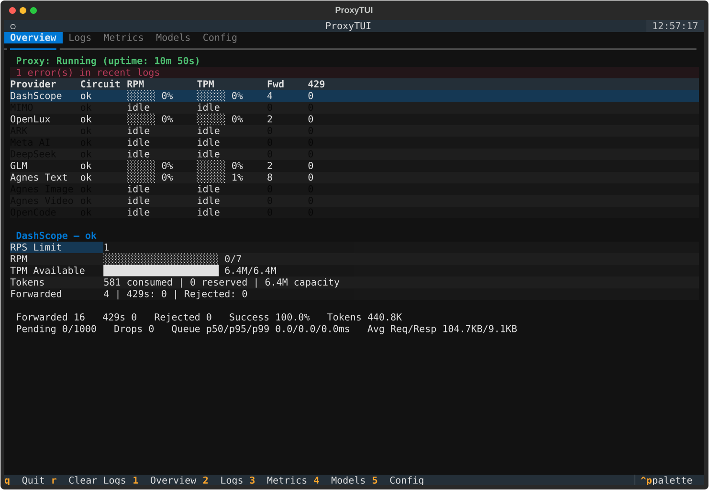
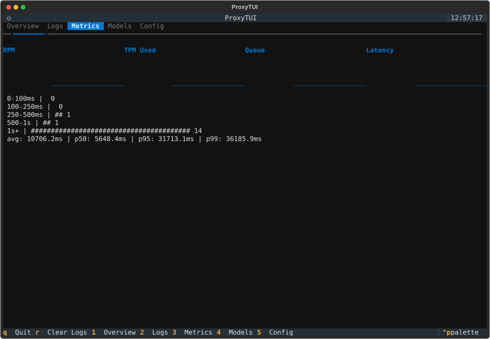
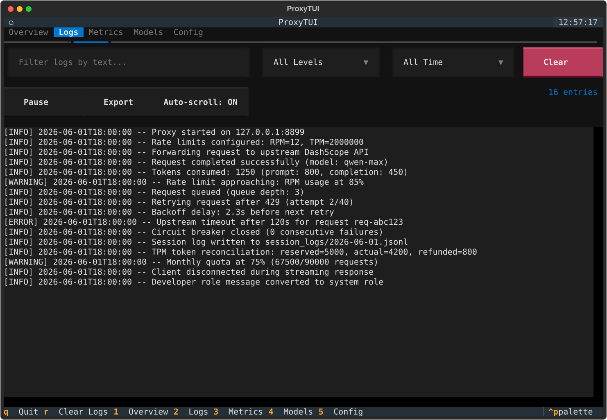
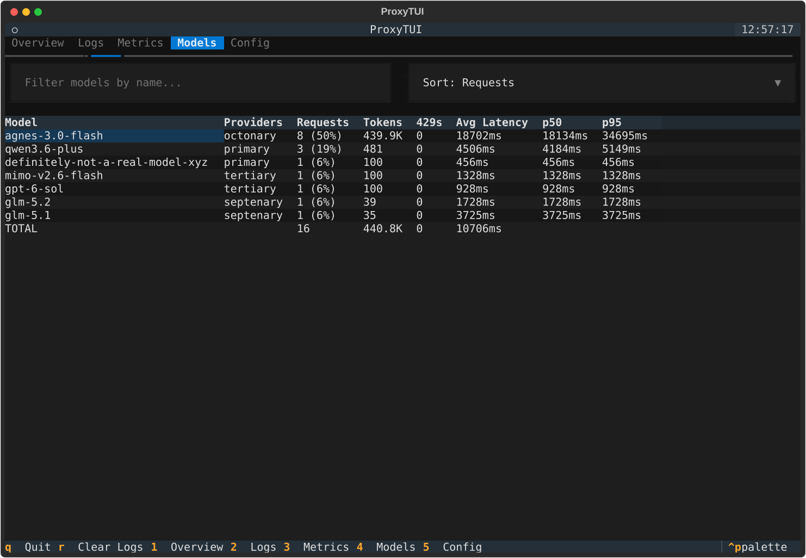
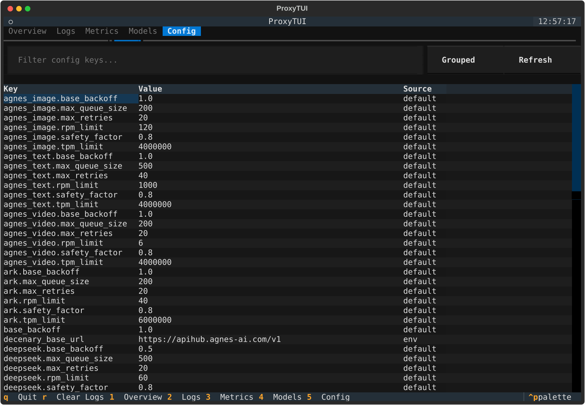

# Coding Plan Proxy

[](https://www.python.org/downloads/)
[](https://github.com/kanishka-namdeo/coding-plan-proxy)
[](https://opensource.org/licenses/MIT)
[](https://github.com/psf/black)

An HTTP proxy for the DashScope Coding API with multi-provider routing, rate limiting, request queuing, automatic retries, and a rich Textual TUI dashboard.

## Table of Contents

- [Quick Start](#quick-start)
- [TUI Dashboard](#tui-dashboard)
- [Features](#features)
- [Endpoints](#endpoints)
- [Configuration](#configuration)
- [Running Tests](#running-tests)

## Quick Start

```powershell
py -m venv .venv
.venv\Scripts\Activate.ps1
py -m pip install -r requirements.txt
# add your API key to .env (see .env.example)
py dashscope_proxy.py           # launches proxy + TUI dashboard
py dashscope_proxy.py --headless # launches proxy without TUI
```

Point your OpenAI-compatible client at `http://127.0.0.1:8899`.

## Why Use This Proxy?

| Feature | Benefit |
|---------|---------|
| **Multi-Provider Routing** | Access 11 AI providers through a single endpoint with automatic failover |
| **Rate Limiting** | Protect your API quotas with RPM/TPM enforcement and safety factors |
| **Circuit Breaker** | Automatic recovery from upstream failures without cascading errors |
| **Request Queuing** | Graceful handling of traffic spikes instead of immediate failures |
| **Live Dashboard** | Real-time monitoring of quotas, latencies, and provider health |
| **Session Logging** | Complete audit trail of all requests for debugging and analysis |
| **Token Accounting** | Accurate TPM tracking with reserve/reconcile/refund lifecycle |
| **Thinking Mode** | Automatic reasoning injection for 16+ model families |

## Technology Stack

- **Runtime**: Python 3.14+ with asyncio
- **HTTP**: aiohttp (async client/server)
- **TUI**: Textual 8.2+ (modern terminal UI framework)
- **Testing**: pytest with 757 tests (unit, integration, audit, e2e)
- **Architecture**: Multi-provider routing with 3-state circuit breaker

## TUI Dashboard

Run the proxy to launch the interactive TUI dashboard. Monitor rate limits, quotas, request metrics, live logs, per-model usage, and configuration in real time.

### Overview Tab

Real-time rate limiter status, RPM/TPM/quotas with progress bars, connection status, and request statistics (success rate, rejected, pending/max queue). Non-primary providers appear as soon as they are configured, including at zero traffic. Live log feed of warnings and errors.



### Metrics Tab

Sparkline charts for RPM, tokens-per-minute, queue depth, and upstream latency. Derived metrics (success rate, latency percentiles), failover events, and a latency histogram.



### Logs Tab

Full log viewer with text search, level filtering, time range selection, pause/resume, auto-scroll toggle, and export to file.



### Models Tab

Per-model usage breakdown: request count with percentage, tokens, 429 errors, average latency, and totals row. Sortable by requests, tokens, latency, or 429s.



### Config Tab

Grouped network, timeout, connection, buffering, logging, and per-provider limit blocks. Filter by key; source column shows env vs default.



### Keyboard Shortcuts

| Key | Action |
|-----|--------|
| `1` | Overview tab |
| `2` | Logs tab |
| `3` | Metrics tab |
| `4` | Models tab |
| `5` | Config tab |
| `r` | Clear logs |
| `q` | Quit |

## Features

### Multi-Provider Routing

**Eleven provider entries supported**
Route requests to DashScope (primary), MIMO (secondary), OpenLux (tertiary), ARK/BytePlus (quaternary), Meta AI/Muse Spark (quinary), DeepSeek (senary), GLM/Z.ai (septenary), Agnes AI (octonary/nonary/decenary), or OpenCode Zen (undenary). Agnes AI is a single vendor with a single Token Plan key, but it contributes three entries — `Agnes Text`, `Agnes Image`, and `Agnes Video` — so each modality's distinct upstream RPM cap gets its own rate limiter. Only the create-task `POST /v1/videos` is proxyable for Agnes Video; poll the result directly against Agnes (see `.env.example`). OpenCode Zen offers a free-catalog of models with $0 token cost (requires a funded account with $20 prepaid balance; anonymous keyless access was disabled on 2026-09-23).

**Provider pinning**
Force a specific provider by prefixing the model name: `openlux/gpt-5.6-sol`, `deepseek/deepseek-flash`, `glm/glm-5.3`, `agnes/agnes-3.0-flash`, `agnes-image/agnes-image-2.1-flash`, `agnes-video/agnes-video-2.5-flash`, `opencode/big-pickle`. Available slugs: `dashscope`, `mimo`, `openlux`, `ark`, `metaspark`, `deepseek`, `glm`, `zai`, `agnes`, `agnes-image`, `agnes-video`, `opencode`. Agnes model IDs are unique across all providers, so a bare model name routes to Agnes without a pin; the pinnable ordinal names (`octonary`, `nonary`, `decenary`, `undenary`) also work.

**Cross-provider failover**
Overlapping models (present in multiple provider lists) support automatic failover on 429/5xx/timeout. After per-provider retries are exhausted, the handler advances to the next available provider with a closed circuit.

**Model overlap detection**
`GET /v1/models` returns `providers` and `provider_models` fields indicating which providers serve each model. `GET /v1/proxy/status` includes `model_overlaps` for models served by 2+ providers.

### Rate Limiting & Quotas

**Multi-layer rate limiting**
Enforces RPS, RPM, and TPM (via Token Bucket). A configurable safety factor keeps usage below the hard limits.

**TPM token lifecycle**
TPM is enforced via a Token Bucket with reserve/reconcile/refund semantics. Tokens are reserved before sending to upstream, reconciled with real token counts after the response, and refunded on errors or client disconnects.

**Deadline-bounded queue waits**
Queue waits respect a configurable deadline (default 120s). The proxy checks for client disconnects between wait iterations and aborts queued requests if the deadline is exceeded.

### Resilience

**Automatic retries**
Retries 429 and 5xx responses with exponential backoff and jitter.

**Request queuing**
Requests that exceed rate limits are placed in a bounded queue instead of failing immediately.

**Circuit breaker**
Opens circuit on repeated upstream failures, preventing cascade failures and allowing recovery.

### Request Handling

**Developer role mapping**
Converts `developer` role messages to `system` for upstream compatibility.

**SSE streaming**
Streams completions through the proxy and aborts if the client disconnects.

**Hop-by-hop header stripping**
Removes connection-specific headers before forwarding to upstream.

**Client disconnect detection**
Detects when clients disconnect and refunds TPM tokens, cancels pending requests.

**Session logging**
All requests and responses are logged to `session_logs/` for audit and debugging.

### Mock & Diagnostics

**Mock model list**
`GET /v1/models` returns a static list of supported models.

**Interactive TUI dashboard**
Five-tab dashboard with live metrics, sparkline charts, log viewer with filters, per-model analytics, and configuration viewer. Keyboard-driven navigation.

## Endpoints

| Endpoint | Description |
|---|---|
| `POST /v1/chat/completions` | Chat completions, proxied through the rate limiter |
| `GET /v1/models` | Model catalog with `providers` and `provider_models` fields |
| `GET /v1/proxy/status` | Current rate limiter metrics, includes `model_overlaps` |
| `GET /health` | Simple health check |
| `GET /ready` | Readiness probe (checks upstream connection) |

## Configuration

Configure via `.env` file (see `.env.example`). Key settings:

| Setting | Default | Description |
|---|---|---|
| `DASHSCOPE_API_KEY` | (required) | Your DashScope API key |
| `PROXY_RPM_LIMIT` | 9 | Max requests per minute (before safety factor) |
| `PROXY_TPM_LIMIT` | 4,000,000 | Max tokens per minute |
| `PROXY_SAFETY_FACTOR` | 0.8 | Multiply all limits by this (0.8 = leave 20% headroom) |
| `PROXY_MAX_QUEUE_SIZE` | 500 | Max requests waiting in queue |
| `PROXY_MAX_RETRIES` | 40 | Max retries on 429 responses |
| `PROXY_BASE_BACKOFF` | 1.0 | Base seconds for exponential backoff |
| `UPSTREAM_TIMEOUT_TOTAL` | 300 | Total timeout for upstream requests (seconds) |
| `MAX_BODY_SIZE` | 52428800 | Max request body size (50 MB) |

### Provider Configuration

Each provider has its own environment variables for API key, base URL, and rate limits:

| Provider | API Key Env Var | Base URL Env Var |
|----------|-----------------|------------------|
| MIMO (secondary) | `MIMO_CODING_PLAN_API_KEY` | `MIMO_CODING_PLAN_TARGET_BASE` |
| OpenLux (tertiary) | `OPENLUX_API_KEY` | `OPENLUX_TARGET_BASE` |
| ARK (quaternary) | `MODEL_ARK_API_KEY` | `MODEL_ARK_TARGET_BASE` |
| Meta AI (quinary) | `META_AI_API_KEY` | `META_AI_TARGET_BASE` |
| DeepSeek (senary) | `DEEPSEEK_API_KEY` | `DEEPSEEK_TARGET_BASE` |
| GLM (septenary) | `GLM_API_KEY` | `GLM_TARGET_BASE` |
| Agnes Text (octonary) | `AGNES_API_KEY` | `AGNES_TARGET_BASE` |
| Agnes Image (nonary) | `AGNES_API_KEY` | `AGNES_TARGET_BASE` |
| Agnes Video (decenary) | `AGNES_API_KEY` | `AGNES_TARGET_BASE` |
| OpenCode Zen (undenary) | `OPENCODE_API_KEY` | `OPENCODE_TARGET_BASE` |

All three Agnes entries share one Token Plan key and base URL (`AGNES_API_KEY`, `AGNES_TARGET_BASE`, default `https://apihub.agnes-ai.com/v1`); they exist as separate entries only so each modality keeps its own rate limiter.

OpenCode Zen's free-catalog models carry $0 token cost but require a funded account with $20 prepaid balance (anonymous keyless access was disabled on 2026-09-23). Free-tier access is also gated at the TLS transport layer, so a local `opencode2api` sidecar is required for that lane — configured via `OPENCODE_ZEN_GATEWAY`. See `.env.example` for details.

Override rate limits per provider with `SECONDARY_RPM_LIMIT`, `TERTIARY_TPM_LIMIT`, `OCTONARY_RPM_LIMIT`, `NONARY_MAX_RETRIES`, `DECENARY_BASE_BACKOFF`, `UNDENARY_RPM_LIMIT`, etc.

### Failover Order

Customize the cross-provider failover order with `MODEL_FALLBACK_ORDER`:

```bash
MODEL_FALLBACK_ORDER=undenary,decenary,nonary,octonary,septenary,senary,quinary,quaternary,tertiary,secondary,primary
```

The default order is `undenary` → `decenary` → `nonary` → `octonary` → `septenary` → `senary` → `quinary` → `quaternary` → `tertiary` → `secondary` → `primary` (descending ordinal, newest provider first).

## Running Tests

```powershell
py -m pytest tests/
```

The test suite includes 757 tests across multiple categories:
- **Unit tests**: Rate limiter, token utilities, request transformation
- **Integration tests**: Handler behavior with mock upstream servers
- **Audit tests**: Edge cases, error handling, security patterns
- **E2E tests**: Real API calls (requires API key)

## Architecture

```
┌─────────────────┐
│  OpenAI Client  │
└────────┬────────┘
         │ POST /v1/chat/completions
         ▼
┌─────────────────────────────────────────┐
│         Coding Plan Proxy               │
│  ┌─────────────────────────────────┐   │
│  │   Request Queue (bounded)       │   │
│  └──────────────┬──────────────────┘   │
│                 ▼                       │
│  ┌─────────────────────────────────┐   │
│  │   Rate Limiter (RPM/TPM/RPS)    │   │
│  └──────────────┬──────────────────┘   │
│                 ▼                       │
│  ┌─────────────────────────────────┐   │
│  │   Provider Router               │   │
│  │   ├─ Primary (DashScope)        │   │
│  │   ├─ Secondary (MIMO)           │   │
│  │   ├─ Tertiary (OpenLux)         │   │
│  │   ├─ ... (11 providers total)   │   │
│  │   └─ Undenary (OpenCode Zen)    │   │
│  └──────────────┬──────────────────┘   │
│                 ▼                       │
│  ┌─────────────────────────────────┐   │
│  │   Circuit Breaker (3-state)     │   │
│  └──────────────┬──────────────────┘   │
└─────────────────┼───────────────────────┘
                  │
                  ▼
         ┌────────────────┐
         │  AI Provider   │
         │  (Upstream)    │
         └────────────────┘
```

**Key components:**
- **Request Queue**: Bounded queue with deadline-based waits and client disconnect detection
- **Rate Limiter**: Multi-layer enforcement (RPM, TPM, RPS) with token bucket and sliding window
- **Provider Router**: Model-based routing with explicit mapping and fallback chains
- **Circuit Breaker**: 3-state (CLOSED → OPEN → HALF_OPEN) with single-probe recovery
- **Session Logger**: Async JSON-line logging with daily rotation and batched flush

## Contributing

Contributions are welcome! Areas where help is especially appreciated:

- **Bug reports**: Open an issue with reproduction steps
- **Feature requests**: Describe the use case and expected behavior
- **Provider additions**: New AI providers following the existing pattern
- **Test coverage**: Edge cases and failure modes
- **Documentation**: Clarifications, examples, and translations

Before contributing, please read `AGENTS.md` for the development workflow and coding standards.

## License

This project is licensed under the MIT License - see the [LICENSE](LICENSE) file for details.

## Acknowledgments

- **Textual** - Modern terminal UI framework for Python
- **aiohttp** - Async HTTP client/server framework
- **All AI providers** - DashScope, MIMO, OpenLux, ARK, Meta AI, DeepSeek, GLM/Z.ai, Agnes AI, OpenCode Zen

## Support

- **Documentation**: See `AGENTS.md` for detailed architecture and development guidelines
- **Examples**: Check `.env.example` for configuration patterns
- **Diagnostics**: Use the TUI dashboard for real-time monitoring and debugging